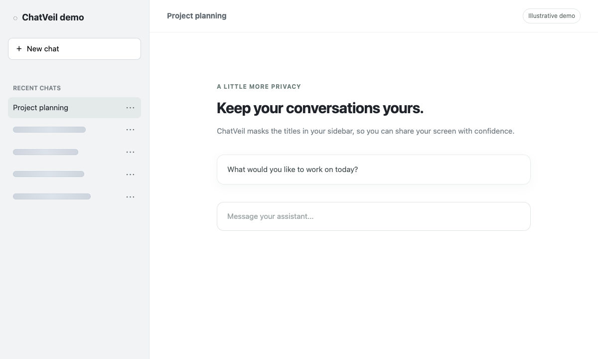
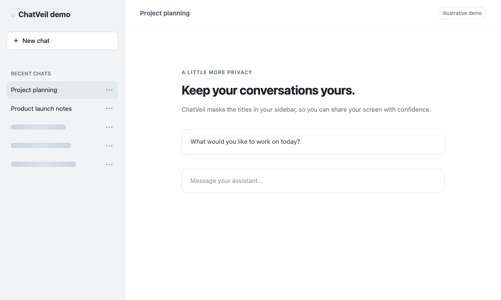
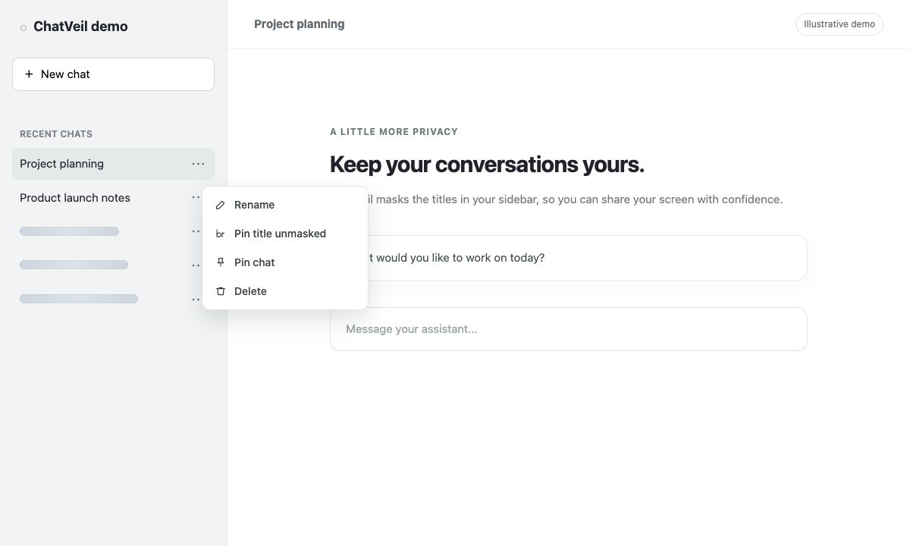

# ChatVeil

English | [简体中文](README.zh-CN.md)

ChatVeil is a local-only privacy tool for chatbot sidebars. It masks non-current conversation titles by default, keeps the current conversation visible, reveals masked titles while hovered or keyboard-focused, and lets users pin individual titles visible from chat menus or with a triple-click.

The project ships the same TypeScript masking core in two forms:

- A Chrome Manifest V3 extension built with WXT.
- A Tampermonkey userscript built with Vite.

## What It Does

- Masks chat history titles without rewriting the original page text.
- Reveals a title temporarily on hover or focus with a soft dynamic mask transition.
- Keeps the active conversation title readable.
- Adds a lightweight menu action to keep individual titles unmasked.
- Stores per-title unlocks as hashed keys instead of raw titles.
- Supports a default dynamic dissolve mask, three additional creative dynamic masks, plus skeleton, character, and blur modes.
- Lets users enable unknown chatbot sites one origin at a time from the popup.

## Supported Sites

- **ChatGPT** — [chatgpt.com](https://chatgpt.com/)
- **Grok** — [grok.com](https://grok.com/)
- **Claude** — [claude.ai](https://claude.ai/)
- **DeepSeek** — [chat.deepseek.com](https://chat.deepseek.com/)
- **Kimi** — [kimi.com](https://kimi.com/) and [kimi.moonshot.cn](https://kimi.moonshot.cn/)
- **Qwen** — [chat.qwen.ai](https://chat.qwen.ai/)

ChatGPT, Claude, DeepSeek, and Qwen have dedicated adapters; Grok and Kimi use the generic sidebar adapter. You can also enable another chatbot site from the popup with permission for that site. Site layouts can change, so menu integration and masking may vary.

## Screenshots

These screenshots show the current masking engine on an illustrative demo page with sample conversations. They use the Skeleton mask; no real chat history is shown.

**Masked history** — the current conversation stays readable while other titles are covered.



**Hover to reveal** — a title is readable while the pointer is over its row.



**Keep a title visible** — choose “Pin title unmasked” from the conversation menu.



## Privacy Model

ChatVeil is designed to stay on the page and in the browser:

- No network calls.
- No telemetry.
- No remote code.
- No title uploads.
- No raw conversation-title storage.
- No destructive text replacement.

The content script adds namespaced `data-chatveil-*` attributes plus CSS/SVG overlays to mask titles visually. Dynamic styles render ephemeral SVG particle layers over the existing title; they do not copy raw titles into persistent storage, `data-*` attributes, canvas buffers, or generated assets. Settings, custom hosts, temporary show-all state, and hashed unlock keys are stored through browser storage or userscript storage. If sync is enabled, settings are also stored using the browser’s sync storage.

## Dynamic Masks

The default `Dissolve` style masks non-current titles as a lighter living particle cloud. Fine particles lightly drift while idle, scatter before a hovered or focused title becomes readable, and gather back when the title is masked again.

Additional creative dynamic styles are available from the popup and userscript panel:

- `Constellation`: denser modeled star glyphs and short constellation-chain curves with varied arcs.
- `Ripple`: quieter dash particles arranged in sparse sine-wave bands.
- `Ember`: soft heat rings and small glow motes that breathe outward and settle back.

The dynamic SVG implementation is tuned for long sidebars:

- One shared animation scheduler drives all dynamic titles instead of one loop per title.
- Offscreen particle layers pause and release their SVG nodes.
- Idle masked titles use a lighter frame cadence.
- Hover, focus, reveal, and remask transitions keep full motion priority.
- `prefers-reduced-motion: reduce` falls back to a simplified low-motion state.

## Project Layout

- `src/core/`: shared adapter, settings, hashing, and masking engine logic.
- `entrypoints/`: WXT extension entry points for content script, background script, and popup UI.
- `src/extension/`: Chrome storage bridge.
- `src/userscript/`: Tampermonkey entry point and in-page controls.
- `tests/`: Vitest coverage for hashing, settings, adapters, and engine behavior.
- `scripts/`: icon generation and Playwright smoke checks.
- `PRIVACY.md`, `PERMISSIONS.md`, `STORE_LISTING.md`: Chrome Web Store support material.
- `PLAN.md`, `PRD_LOOP.md`, `COMPLETION_AUDIT.md`: implementation plan, loop tracking, and completion evidence.

## Quick Start

```bash
npm install
npm run generate:icons
npm run lint
npm run test
npm run build
```

Useful development commands:

```bash
npm run dev
npm run typecheck
npm run test:smoke
npm run build:extension
npm run build:userscript
```

## Build Artifacts

- Extension zip for Chrome Web Store: `.output/chatveil-0.2.0-chrome.zip`
- Unpacked extension: `.output/chrome-mv3/`
- Userscript: `dist/userscript/chatveil.user.js`

Build artifacts are generated locally and ignored by git.

## Manual Acceptance

1. Run `npm run build:extension`.
2. Open `chrome://extensions`, enable Developer Mode, and load `.output/chrome-mv3` as an unpacked extension.
3. Visit a supported site such as ChatGPT, Claude, or Qwen.
4. Confirm the current conversation title remains visible while non-current titles are masked.
5. Hover or focus a masked title and confirm particles scatter before the title becomes readable.
6. Triple-click a masked title and confirm it stays visible after refresh.
7. Open the popup, disable and re-enable the current site, use `Show All 10m`, reset unlocks, and switch mask styles.
8. For a custom chatbot site, enable it from the popup and confirm the optional single-origin permission request appears.
9. Run `npm run build:userscript`, install `dist/userscript/chatveil.user.js` in Tampermonkey, and repeat the known-site checks.

## License

MIT
