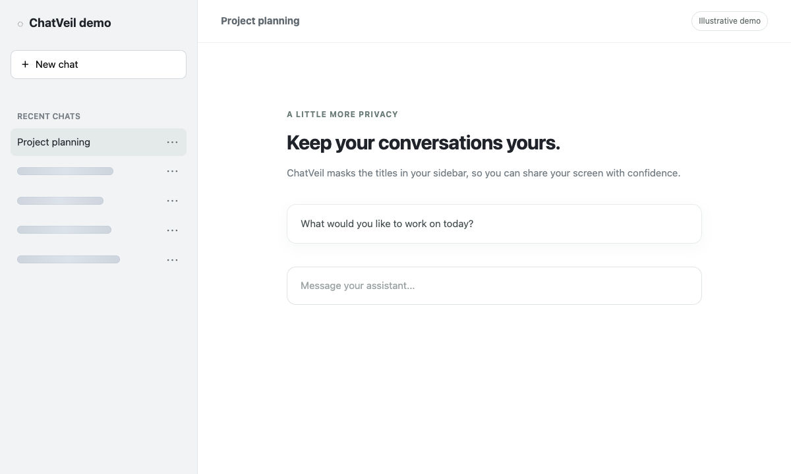
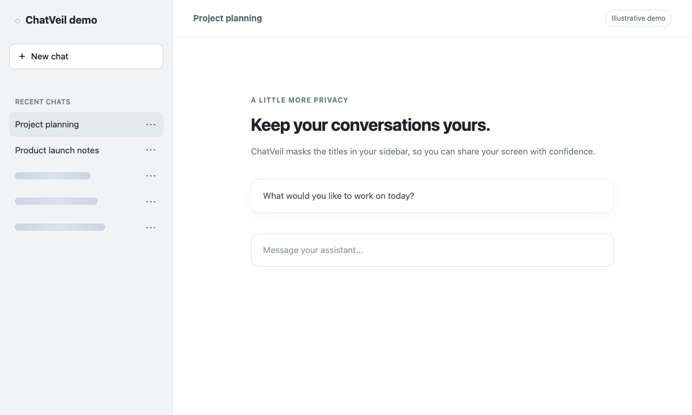
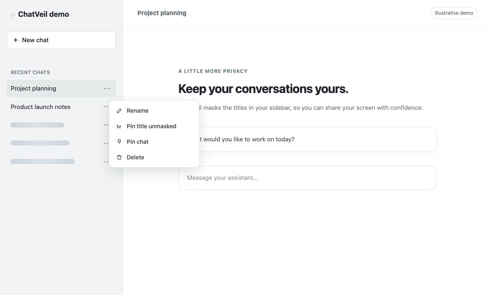

# ChatVeil

[English](README.md) | 简体中文

ChatVeil 是一个在本地运行的聊天记录隐私工具。它默认遮挡聊天网站侧栏中非当前会话的标题；鼠标悬停或键盘聚焦时可临时查看，也可以通过会话菜单或三击标题将单条会话设为持续显示。

项目提供两种形式，共用同一套 TypeScript 遮挡核心：

- 使用 WXT 构建的 Chrome Manifest V3 扩展。
- 使用 Vite 构建的 Tampermonkey 用户脚本。

## 功能

- 遮挡历史会话标题，不改写网页中的原始文字。
- 悬停或聚焦时临时显示标题，移开后重新遮挡。
- 保持当前会话标题可读。
- 通过会话菜单或三击标题，将单条标题固定为可见。
- 使用哈希键保存单条标题的解锁状态，不保存原始标题。
- 提供默认的动态粒子效果、三种其他动态样式，以及骨架条、字符和模糊样式。
- 可在扩展弹窗中按站点启用其他聊天网站。

## 支持的站点

- **ChatGPT** — [chatgpt.com](https://chatgpt.com/)
- **Grok** — [grok.com](https://grok.com/)
- **Claude** — [claude.ai](https://claude.ai/)
- **DeepSeek** — [chat.deepseek.com](https://chat.deepseek.com/)
- **Kimi** — [kimi.com](https://kimi.com/) 和 [kimi.moonshot.cn](https://kimi.moonshot.cn/)
- **Qwen** — [chat.qwen.ai](https://chat.qwen.ai/)

ChatGPT、Claude、DeepSeek 和 Qwen 使用专用适配器；Grok 和 Kimi 使用通用侧栏适配器。其他聊天网站可通过扩展弹窗单独授权并启用。网站布局可能发生变化，遮挡和菜单集成的效果也可能随之不同。

## 效果截图

以下截图来自使用当前遮挡引擎的演示页面，使用的是示例会话和骨架条样式，并非真实聊天记录。

**默认遮挡**：当前会话保持可读，其他会话标题被遮挡。



**悬停查看**：将鼠标移到会话行上，临时显示对应标题。



**固定显示**：在会话菜单中选择 “Pin title unmasked”。



## 隐私设计

ChatVeil 的遮挡处理在页面和浏览器内完成：

- 扩展本身不发起网络请求，不使用遥测或远程代码。
- 不上传标题，不持久化存储原始会话标题。
- 不修改或替换网页中的原始标题文字。

内容脚本通过 `data-chatveil-*` 标记和 CSS/SVG 效果实现视觉遮挡。动态粒子不会将原始标题复制到持久化存储、`data-*` 属性、画布缓冲区或生成资源中。设置、自定义站点、临时显示状态和哈希后的解锁键保存在浏览器存储或用户脚本存储中；启用同步时，设置使用浏览器的同步存储。

## 遮挡样式

默认的 `Dissolve` 会以轻微漂浮的粒子遮挡标题，悬停或聚焦时粒子散开，重新遮挡时粒子聚合。弹窗和用户脚本面板中还可以选择：

- `Constellation`：星点和短连线组成的效果。
- `Ripple`：稀疏波形中的短线粒子。
- `Ember`：柔和的光环与微光粒子。
- `Skeleton`、`Characters`、`Blur`：骨架条、字符和模糊遮挡。

动态效果使用共享动画调度器，并暂停屏幕外的粒子；启用系统减少动态效果设置时会使用简化状态。

## 开发与构建

```bash
npm install
npm run generate:icons
npm run lint
npm run test
npm run build
```

其他常用命令：

```bash
npm run dev
npm run typecheck
npm run test:smoke
npm run build:extension
npm run build:userscript
```

构建产物：

- Chrome Web Store 上传包：`.output/chatveil-0.2.0-chrome.zip`
- 已解压的扩展目录：`.output/chrome-mv3/`
- 用户脚本：`dist/userscript/chatveil.user.js`

构建产物在本地生成，不纳入 Git 版本管理。

## 本地安装与检查

1. 运行 `npm run build:extension`。
2. 打开 `chrome://extensions`，启用开发者模式，点击“加载已解压的扩展程序”，选择 `.output/chrome-mv3/`。该目录是隐藏目录，macOS 可在文件选择器中按 `⌘ + Shift + G` 输入完整路径。
3. 打开支持的聊天网站，确认当前标题可见，其他标题被遮挡；悬停或聚焦后应能临时查看。
4. 在会话菜单中选择 “Pin title unmasked”，或三击标题，并确认刷新后仍保持可见。
5. 在扩展弹窗中检查启用开关、临时显示全部、重置解锁和样式切换。
6. 如需使用用户脚本，运行 `npm run build:userscript`，将 `dist/userscript/chatveil.user.js` 安装到 Tampermonkey 后检查。

## 项目结构

- `src/core/`：站点适配、设置、哈希和遮挡核心。
- `entrypoints/`：扩展的内容脚本、后台脚本和弹窗。
- `src/extension/`：Chrome 存储适配。
- `src/userscript/`：用户脚本入口和页面内控制面板。
- `tests/`、`scripts/`：测试、浏览器冒烟检查和图标生成。
- `PRIVACY.md`、`PERMISSIONS.md`、`STORE_LISTING.md`：隐私和商店材料。

## 许可证

MIT
